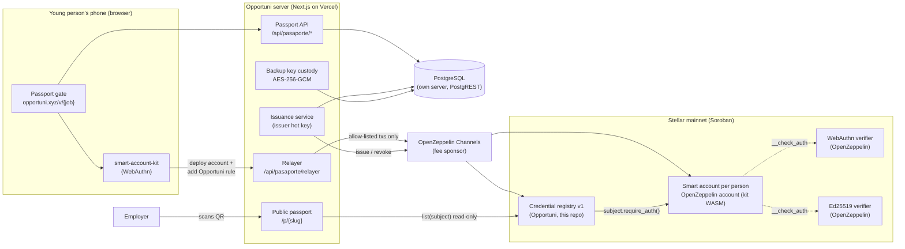
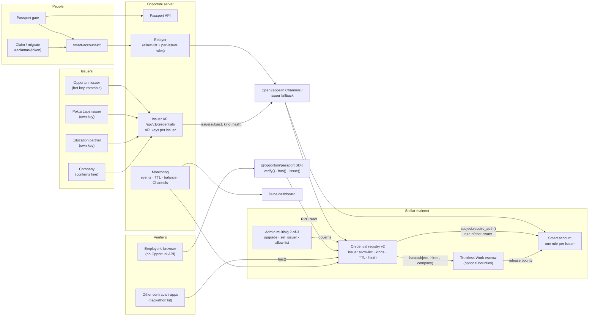
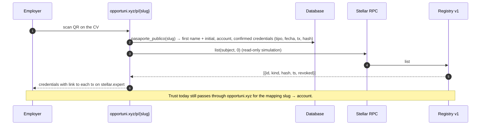
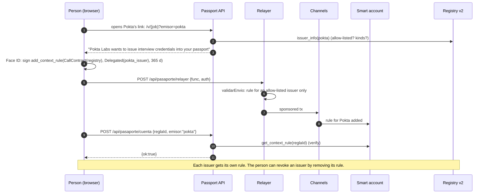
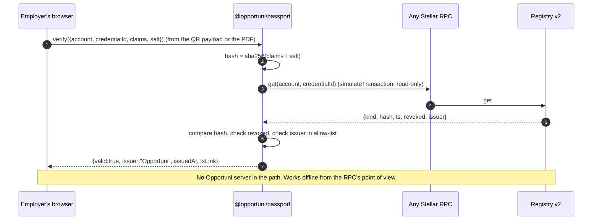
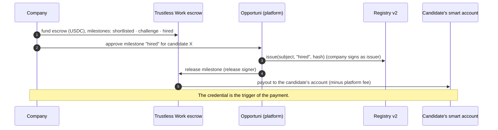

# Opportuni Passport · Technical architecture

Verifiable talent credentials on Stellar for a community of 12k+ young people in Mexico, Colombia and Spain. Every job link Opportuni shares opens through the Passport: the first time, the young person gets a smart account on Stellar mainnet secured with Face ID or fingerprint (passkey); from then on, credentials about them are issued into that account and any employer can verify them on-chain without trusting Opportuni.

This document has two halves: **what runs on mainnet today (v1)** and **what the SCF Build award funds (v2)**. Everything marked *planned* is not built yet.

| | |
|---|---|
| **Status** | v1 live on Stellar **mainnet since 29 Sep 2026** |
| **Registry contract (v1)** | [`CCYQALCXWORBUAOI2AXRPBRI4JOK2UHYXOZIJZTGKK3MOZAV7LK3CC7P`](https://stellar.expert/explorer/public/contract/CCYQALCXWORBUAOI2AXRPBRI4JOK2UHYXOZIJZTGKK3MOZAV7LK3CC7P) |
| **Issuer account** | [`GCJOMP6DCXSM6SIGGTTVZEQAQLPY5TKCH263F66HRSR5DMBXGOY5C6GX`](https://stellar.expert/explorer/public/account/GCJOMP6DCXSM6SIGGTTVZEQAQLPY5TKCH263F66HRSR5DMBXGOY5C6GX) |
| **Contract source** | [`contracts/credential-registry`](../contracts/credential-registry) (Rust, soroban-sdk 28, Protocol 28) |
| **On-chain dashboard** | [dune.com/opportunixyz/opportuni](https://dune.com/opportunixyz/opportuni) · queries in [`analytics/dune`](../analytics/dune) |
| **Real-time numbers** | [opportuni.xyz/traccion](https://opportuni.xyz/traccion) |
| **License** | MIT ([LICENSE](../LICENSE)): contract, SDK and app |
| **Stack** | Next.js 14 on Vercel · PostgreSQL + PostgREST on our own server · `smart-account-kit` 0.8 (OpenZeppelin smart accounts) · `@stellar/stellar-sdk` 16.3 · OpenZeppelin Channels for fees · Cloudflare Turnstile |
| **Product spec (Spanish)** | [prd-pasaporte-opportuni.md](prd-pasaporte-opportuni.md) · routes: [rutas.md](rutas.md) |

## 0. Today vs. end of the award

| Capability | Today (v1, mainnet) | End of award (v2) |
|---|---|---|
| Accounts | Passkey smart account per person, Ed25519 backup when the passkey fails | Same, plus **claim flow**: backup → passkey, custodial key deleted |
| Who can issue | **One issuer** (Opportuni) | **Issuer allow-list** with the kinds each issuer may emit; first external issuer: Pokta Labs |
| Person's consent | One context rule authorizes Opportuni | **One context rule per issuer**, each approved with the passkey |
| Credential kinds | `cv_verif` | `cv_verif`, `linkedin_rev`, `interview` (Pokta), `hired` (company-confirmed), partner course credentials |
| Verification | `opportuni.xyz/p/{slug}` reads the registry | **Browser-side verification** (no Opportuni API in the path), **TypeScript SDK** (`verify`, `has`, `issue`), on-chain `has()` for other contracts |
| Admin | Same hot key issues and upgrades | **Admin multisig 2-of-3** for `upgrade`, `set_issuer`, allow-list; issuer stays a rotatable hot key |
| Storage TTL | Instance extended on writes; credential entries at network minimum | `extend_ttl` on every credential and counter, **monitoring** that extends before expiry |
| Observability | Dune dashboard + `/traccion` | **STRIDE threat model**, on-chain monitoring plan, alerts on issuer balance, Channels failures, issuance spikes, TTL |
| Money | Fees sponsored by Channels | Optional: **hiring bounties** released from a Trustless Work escrow into the person's account when the `hired` credential is issued |

## 1. Architecture today (v1)



| Component | What it is | Who runs it |
|---|---|---|
| **Smart account** | One OpenZeppelin smart account per person, deployed from the WASM `smart-account-kit` already has on mainnet. Signer: a **passkey** (WebAuthn verifier) or, as a fallback, an **Ed25519 key** held in encrypted custody by Opportuni. | The person (passkey) / Opportuni (backup) |
| **Delegated permission** | A **context rule** on the account: `CallContract(registry)` with `Delegated(issuer)` as signer, valid 365 days (6,307,200 ledgers). It lets the issuer satisfy `subject.require_auth()` **only** for calls to the registry. No transfers, no other contracts. | Signed once by the person with Face ID / fingerprint |
| **Credential registry** | Our Soroban contract. Per subject account: `(id, kind, salted hash, timestamp, revoked)`. Events `issued`, `revoked`, `issuer_changed`. Upgradeable in place. | Opportuni (this repo) |
| **Relayer** | Our route in front of Channels. Forwards **only two** transaction shapes: deploying a passkey account (kit deployer, kit WASM, one WebAuthn signer) and adding the Opportuni rule. Anything else is rejected. | Opportuni |
| **Fee sponsor** | Channels pays network fees; if it fails, the issuer pays (cap 0.5 XLM/tx). Global cap: 600 sends/hour. | OpenZeppelin / Opportuni |
| **Public passport** | `opportuni.xyz/p/{slug}` (the QR on the CV): first name, initial, and confirmed credentials with their tx on stellar.expert. | Opportuni |
| **Database** | Passports, devices, job clicks, credential queue, audit log. Personal data lives **only** here. | Opportuni, own server |

## 2. Target architecture (v2, end of the award)



What changes, and why it matters for the ecosystem:

1. **Registry v2** turns a single-issuer log into a **multi-issuer credential layer**: any approved organisation can issue into a person's account, with the person's explicit passkey consent per issuer, and anyone (including other Soroban contracts) can check `has(subject, kind, issuer)`.
2. **Browser-side verification and SDK** remove Opportuni from the trust path: an employer verifies against the chain, not against our API.
3. **Admin multisig and monitoring** make the registry operable as infrastructure, not as a startup's side table.
4. **Credential-gated payments**: the `hired` credential can release an escrowed hiring bounty straight into the young person's account, which is the first flow where the credential moves money.

## 3. Sequence diagrams

### 3.1 Today · Passport creation (first click on a job link)

```mermaid
sequenceDiagram
  autonumber
  participant P as Person (browser)
  participant S as Passport API
  participant R as Relayer
  participant C as Channels
  participant A as Smart account
  participant DB as Database

  P->>S: POST /api/pasaporte {vacante, canal, respuestas, terminos, turnstile}
  S->>S: Validate form, Turnstile, rate limits
  S->>DB: crear_pasaporte(...)  (slug, device token hash)
  S-->>P: 200 {ok, destino, registrado:true} + cookie opp_dev (httpOnly)
  alt Passkey available (Face ID / fingerprint)
    P->>P: Face ID #1: create passkey (rpId opportuni.xyz)
    P->>R: POST /api/pasaporte/relayer {func, auth}  (deploy account)
    R->>R: validarEnvio: kit deployer, kit WASM, 1 WebAuthn signer
    R->>C: sponsored tx
    C->>A: account deployed
    R-->>P: {success, data:{hash, status}}
    P->>P: Face ID #2: sign add_context_rule
    P->>R: POST /api/pasaporte/relayer {func, auth}  (add rule)
    R->>R: validarEnvio: CallContract(registry), Delegated(issuer), no policies
    R->>C: sponsored tx
    C->>A: rule added
    P->>S: POST /api/pasaporte/cuenta {contractId, credentialId, publicKey, reglaId}
    S->>A: get_context_rule(0), get_context_rule(reglaId)  (read-only)
    S->>DB: save account (modo passkey, estado lista)
    S-->>P: {ok:true, estado:"lista"}
  else Passkey fails, cancelled, or in-app browser
    P->>S: POST /api/pasaporte/cuenta {resultado:"fallo", motivo}
    S->>S: cuenta_tomar(slug) lock
    S->>C: deploy account with Ed25519 signer (issuer as deployer)
    S->>C: add_context_rule signed with the backup key
    S->>DB: save account (modo respaldo), key encrypted AES-256-GCM
  end
  S-->>P: redirect to the job (destino)
  Note over P,A: Fees paid by Channels; if Channels fails the issuer pays (cap 0.5 XLM/tx).
```

### 3.2 Today · Credential issuance (`cv_verif`)

```mermaid
sequenceDiagram
  autonumber
  participant Op as Operator (/admin or MCP tool emitir_cv_verificado)
  participant S as Issuance service
  participant DB as Database
  participant C as Channels
  participant Reg as Registry v1
  participant A as Subject's smart account

  Op->>S: issue cv_verificado to passport X
  S->>DB: insert credenciales {tipo, hash, salt, estado:"pendiente"}
  S->>S: hash = sha256(credential JSON ‖ salt)
  S->>Reg: simulate issue(subject, "cv_verif", hash)
  S->>S: sign auth entries with the issuer key<br/>(as issuer, and as Delegated signer inside the subject's entry)
  S->>C: submit (fallback: issuer pays)
  Reg->>A: subject.require_auth() → __check_auth(rule CallContract(registry), signer Delegated(issuer))
  A-->>Reg: ok
  Reg->>Reg: issuer.require_auth(); store Cred(subject,id); publish issued
  Reg-->>S: id
  S->>DB: update credenciales {estado:"confirmada", tx_hash}
  S-->>Op: confirmed, link to tx
```

### 3.3 Today · Verification through the public passport



### 3.4 Planned · Person approves an external issuer (Pokta Labs)



### 3.5 Planned · External issuance through the Issuer API

```mermaid
sequenceDiagram
  autonumber
  participant I as Pokta Labs backend
  participant API as Issuer API /api/v1/credentials
  participant DB as Database
  participant C as Channels
  participant Reg as Registry v2
  participant A as Subject's smart account

  I->>API: POST {subject, kind:"interview", claims, idempotency_key}  Authorization: Bearer <issuer API key>
  API->>API: auth issuer, check kind allowed, rate limit
  API->>DB: insert credential (pendiente), salt, hash = sha256(claims ‖ salt)
  API-->>I: 202 {credential_id, status:"pending"}
  API->>Reg: simulate issue(subject, "interview", hash)
  API->>I: webhook "sign_request" {auth_entry_xdr}  (Pokta signs with its own key)
  I-->>API: {signed_auth_entry_xdr}
  API->>C: submit
  Reg->>A: subject.require_auth() → __check_auth(rule of Pokta)
  Reg->>Reg: require_auth(pokta); allowed(pokta, "interview"); store; extend_ttl; publish issued
  API->>DB: confirmada + tx_hash
  API->>I: webhook "credential.confirmed" {credential_id, tx_hash}
  Note over I,Reg: Alternative for small partners: Opportuni co-signs as a "sponsor issuer" and the partner only signs claims off-chain.
```

### 3.6 Planned · Claim: from backup account to passkey

```mermaid
sequenceDiagram
  autonumber
  participant P as Person
  participant W as /reclamar/{token}
  participant S as Passport API
  participant R as Relayer
  participant A as Smart account

  P->>W: opens claim link (sent by WhatsApp after a credential, or from /p/{slug})
  W->>S: GET /api/pasaporte/reclamar/{token} → account, pending credentials
  P->>P: Face ID: create passkey
  P->>R: add_signer(WebAuthn signer) signed with the custodial Ed25519 key (server co-signs)
  R->>A: signer added
  P->>R: remove_signer(Ed25519 custodial)
  R->>A: custodial signer removed
  S->>S: delete clave_cifrada; modo → passkey
  S-->>P: "Your passport is now only yours"
```

### 3.7 Planned · Browser-side verification with the SDK



### 3.8 Planned · Credential-gated hiring bounty (optional, Integration Track)



## 4. Smart contract interface

### 4.1 Registry v1 (deployed)

Source: [`contracts/credential-registry/src/lib.rs`](../contracts/credential-registry/src/lib.rs). Tests: [`src/test.rs`](../contracts/credential-registry/src/test.rs) (auth of issuer and subject, revoke, paging, issuer rotation).

| Function | Who must authorize | What it does |
|---|---|---|
| `__constructor(issuer)` | deployer | Sets the issuer (instance storage) |
| `issue(subject, kind: Symbol, hash: BytesN<32>) -> u64` | **subject** (via its delegated rule) **and issuer** | Appends a credential, bumps the subject's counter, publishes `issued`. `subject.require_auth()` runs first so the account's `__check_auth` can resolve the delegated issuer signature |
| `revoke(subject, id)` | issuer | Marks the credential revoked (`AlreadyRevoked` if repeated), publishes `revoked` |
| `get(subject, id) -> Credential` | nobody (read) | One credential |
| `count(subject) -> u64` | nobody (read) | Number of credentials |
| `list(subject, start) -> Vec<Credential>` | nobody (read) | Pages of 50 |
| `issuer() -> Address` | nobody (read) | Current issuer |
| `set_issuer(new_issuer)` | issuer | Rotates the issuer, publishes `issuer_changed` |
| `upgrade(wasm_hash)` | issuer | `update_current_contract`: new code, **same contract ID**, same storage |

```rust
pub struct Credential { id: u64, kind: Symbol, hash: BytesN<32>, ts: u64, revoked: bool }
enum DataKey { Issuer, Count(Address), Cred(Address, u64) }
// Events
Issued { #[topic] subject: Address, id: u64, kind: Symbol, hash: BytesN<32> }
Revoked { #[topic] subject: Address, id: u64 }
IssuerChanged { issuer: Address }
```

Storage: instance (issuer) extended to 120 days when under 60 on every write; persistent `Count` and `Cred` entries (about 0.1 XLM each at issuance, rent included) currently at the network minimum TTL.

### 4.2 Registry v2 (planned, same contract ID via `upgrade`)

| Function | Who must authorize | What it does |
|---|---|---|
| `init_v2(admin)` | current issuer (one-time migration) | Sets the admin (multisig) and moves the current issuer into the allow-list with kind `cv_verif` |
| `add_issuer(issuer, kinds: Vec<Symbol>, name)` | admin | Allow-lists an issuer and the kinds it may emit; publishes `issuer_added` |
| `set_issuer_kinds(issuer, kinds)` / `remove_issuer(issuer)` | admin | Updates or removes an issuer; existing credentials stay, flagged with their issuer |
| `issue(subject, kind, hash, expires_at: Option<u64>) -> u64` | **subject and the calling issuer** | Checks the issuer is allow-listed for `kind`, stores `(id, kind, hash, ts, expires_at, issuer, revoked)`, `extend_ttl` on `Cred` and `Count`, publishes `issued` with `issuer` |
| `revoke(subject, id)` | the issuer that issued it, or admin | Revokes; publishes `revoked` |
| `has(subject, kind, issuer: Option<Address>) -> bool` | nobody (read) | True if the subject holds a non-revoked, non-expired credential of that kind (from that issuer, if given). For other contracts (escrows, DAOs, grants) |
| `get`, `count`, `list`, `issuers() -> Vec<IssuerInfo>` | nobody (read) | Reads |
| `extend(subject, id)` | anybody | Extends the TTL of one credential (used by the monitoring job) |
| `set_admin(new_admin)` / `upgrade(wasm_hash)` | admin | Governance |

```rust
pub struct Credential { id: u64, kind: Symbol, hash: BytesN<32>, ts: u64, expires_at: Option<u64>, issuer: Address, revoked: bool }
pub struct IssuerInfo { address: Address, name: String, kinds: Vec<Symbol>, active: bool }
enum DataKey { Admin, Issuer(Address), Issuers, Count(Address), Cred(Address, u64) }
```

Migration: `upgrade` keeps the contract ID and the existing `Cred`/`Count` entries; v2 reads v1 entries by filling `issuer = Opportuni` and `expires_at = None` on access. Existing context rules keep working because they reference the contract address. Rehearsal on testnet (deploy v1, issue, upgrade, verify old credentials and rules) is a deliverable before the mainnet upgrade.

## 5. API reference · today

All endpoints are JSON over HTTPS on `opportuni.xyz`. The device is identified by the `opp_dev` cookie (httpOnly, SameSite=Lax, random token; only its SHA-256 is stored). *Rate limits are per IP unless noted.*

### `POST /api/pasaporte` · create a passport

Called by the gate after the form. Requires Cloudflare Turnstile; if the widget could not load, the client sends `sinTurnstile: true` and the passport is created as unverified (cap 30/hour).

```json
// request
{
  "vacante": "job-pokta-labs",            // job slug (optional: null when claiming)
  "canal": "mx-cdmx-1",                   // WhatsApp group slug (optional)
  "terminos": true,                       // must be true
  "turnstile": "<token>",                 // Turnstile token (or omitted)
  "sinTurnstile": false,
  "respuestas": {
    "nombre": "Ana Pérez",
    "whatsapp_lada": "+52",
    "whatsapp": "55 1234 5678",           // 10 digits for +52/+57, 9 for +34
    "estado": "Ciudad de México",
    "areas": ["Ingeniería", "Tecnología"],
    "rango_edad": "21 a 24"
  }
}
```

| Status | Body | When |
|---|---|---|
| 200 | `{"ok":true,"destino":"https://…","registrado":true}` + `Set-Cookie: opp_dev` | Created. `destino` is the job's URL |
| 200 | `{"ok":true,"destino":"…","registrado":false}` | Database unavailable: the person still reaches the job |
| 400 | `{"ok":false,"error":"…","clave":"whatsapp"}` | Validation error; `clave` is the field |
| 403 | `{"ok":false,"error":"…"}` | Turnstile failed and the unverified cap is reached |
| 409 | `{"ok":false,"existe":true,"error":"Ese WhatsApp ya tiene pasaporte."}` | WhatsApp already registered |
| 429 | `{"ok":false,"error":"Demasiados intentos…"}` | Rate limit |

### `POST /api/pasaporte/entrar` · "I already have a passport" with WhatsApp

Links the device to an existing passport as **unconfirmed** (counts clicks; cannot trigger on-chain actions).

```json
{ "vacante": "job-pokta-labs", "canal": null, "lada": "+52", "numero": "5512345678", "turnstile": "<token>", "sinTurnstile": false }
```

200 `{"ok":true,"destino":"…","registrado":true}` + cookie · 404 `{"ok":false,"noEncontrado":true}` · 400 / 403 / 429 as above. Limit: 10 per 10 min per IP; without Turnstile, 3 per 10 min.

### `GET /api/pasaporte/reto` · WebAuthn challenge

200 `{"ok":true,"reto":"<base64url>"}` · 503 `{"ok":false}`. The challenge is 24 bytes (timestamp + random) plus an HMAC, so the server verifies it later without storing it. `Cache-Control: no-store`.

### `POST /api/pasaporte/passkey` · "I already have a passport" with Face ID / fingerprint

Links the device as **confirmed** after verifying an ES256 assertion against the stored public key (`rpId` = `opportuni.xyz`, origin checked, challenge HMAC checked, counter and flags checked).

```json
{
  "vacante": "job-pokta-labs",
  "canal": null,
  "asercion": {
    "credentialId": "<base64url>",
    "clientDataJSON": "<base64url>",
    "authenticatorData": "<base64url>",
    "signature": "<base64url>"
  }
}
```

200 `{"ok":true,"destino":"…","registrado":true}` + cookie · 404 `{"ok":false,"noEncontrado":true}` (unknown credential or bad signature) · 400 · 429 (10 per 10 min).

### `POST /api/pasaporte/cuenta` · report how the on-chain account ended

Requires a **confirmed** device cookie (401 otherwise). Two shapes:

```json
// a) the browser created the passkey account
{ "contractId": "C…", "credentialId": "<base64url>", "publicKey": "<base64url 65-byte P-256>", "reglaId": 1 }
// b) the passkey failed
{ "resultado": "fallo", "motivo": "cancelada", "detalle": "NotAllowedError: …" }
// motivo ∈ sin_soporte | sin_autenticador | cancelada | error | inapp | regla_cancelada | regla_error
```

For (a) the server **re-derives the account address from `credentialId`** (kit deployer + sha256 salt), reads rule 0 on-chain to confirm it holds that WebAuthn key, and reads `reglaId` to confirm it is the Opportuni rule and still valid. Response `{"ok":true,"estado":"lista"}`; `estado` ∈ `lista` · `sin_permiso` (account ok, rule missing) · `invalida` · `ya_tiene`. For (b) `{"ok":true}` and the server deploys the backup account (unless the failure was only at the rule step). If Stellar is not configured: `{"ok":true,"stellar":false}`.

### `POST /api/pasaporte/relayer` · sponsored submission (kit relayer)

Requires a confirmed device. Limits: 12 per 10 min per IP, 6 per 10 min per passport.

```json
// request: XDR produced by smart-account-kit in the browser
{ "func": "<base64 XDR HostFunction>", "auth": ["<base64 XDR SorobanAuthorizationEntry>"] }
// response
{ "success": true, "data": { "transactionId": "…", "hash": "<64 hex>", "status": "SUCCESS" } }
```

`validarEnvio` accepts exactly two shapes, otherwise 400 `{"success":false,"error":"Transacción no permitida."}`:
1. `CreateContractV2` from the kit deployer `GAAH4OT3…WQ4N`, executable = kit account WASM hash, constructor `([External(webauthn_verifier, key)], {})` with one signer.
2. `InvokeContract(account, "add_context_rule", [CallContract(registry), "Opportuni", valid_until, [Delegated(issuer)], {}])` signed by that account.

Other statuses: 401 no passport on this device · 429 · 502 Channels failed (`error` has the reason) · 503 Stellar not configured or database down.

### `GET /p/{slug}` · public passport (HTML)

Data behind the page (`pasaporte_publico`):

```json
{ "slug": "pdbmta67", "nombre": "Vianey A.", "desde": "2026-09-30T15:57:17Z",
  "cuenta": "CCEW22GO…", "modo": "passkey",
  "credenciales": [ { "tipo": "cv_verificado", "fecha": "2026-10-06T05:38:32Z", "tx": "<64 hex>", "hash": "<64 hex>" } ] }
```

Only confirmed credentials are shown; name is first name plus initial. Each credential links to its transaction on stellar.expert.

### `GET /traccion` · public real-time traction (HTML)

Accounts (passkey vs backup), credentials, passports and the last accounts, read from the database with on-chain links. Dune is linked for the verifiable version.

### Operator surfaces (team only)

- **`/api/admin/*`** (session cookie): jobs, group links, who opened what, PDF reports in percentages, form questions, team users, `POST /api/admin/jovenes` issues `cv_verificado`. Full list in [rutas.md](rutas.md).
- **MCP server `/api/mcp`** (OAuth 2.1 with PKCE, refresh rotation): tools `listar_vacantes`, `crear_vacante`, `links_por_grupo`, `prender_apagar_vacante`, `cifras_de_vacante`, `quien_abrio_vacante`, `impacto_de_grupos`, `crear_grupo`, `buscar_jovenes`, `vacantes_de_joven`, `emitir_cv_verificado`, `reporte_para_empresa`. Every write is logged to `admin_audit`.

## 6. API · planned for v2

| Endpoint | Auth | Purpose |
|---|---|---|
| `POST /api/v1/credentials` | Issuer API key (`Authorization: Bearer`) | External issuance: `{subject, kind, claims, expires_at?, idempotency_key}` → `202 {credential_id, status:"pending"}`; confirmation by webhook |
| `GET /api/v1/credentials/{id}` | Issuer API key | Status, tx hash, revocation |
| `POST /api/v1/credentials/{id}/revoke` | Issuer API key (same issuer) | Revoke |
| `GET /api/v1/accounts/{account}/credentials` | public | Read-through to the registry plus the off-chain claims the person chose to publish |
| `POST /api/v1/webhooks` | Issuer API key | Register `sign_request`, `credential.confirmed`, `credential.revoked` |
| `GET /api/pasaporte/reclamar/{token}` · `POST /api/pasaporte/reclamar` | claim token + passkey | Claim a backup account: add passkey signer, remove custodial signer |
| `GET /api/pasaporte/emisores` | device cookie | Issuers the person has approved, and pending requests |
| `GET /.well-known/opportuni-passport.json` | public | Registry address, admin, issuer allow-list snapshot, SDK version |

SDK (`@opportuni/passport`, TypeScript, MIT): `verify({account, credentialId, claims, salt})`, `has(account, kind, issuer?)`, `list(account)`, `issue(...)` for issuers, `buildIssuerRule(issuer)` for the per-issuer consent step. Sandbox on testnet with an open allow-list for hackathons.

## 7. On-chain vs. off-chain

| On-chain (public) | Off-chain (Opportuni database) |
|---|---|
| Smart account address per person | Name, WhatsApp, state, areas of interest, age range |
| Context rules: registry address, issuer address, expiry | Which jobs each person opened, when, from which device |
| Credential `kind`, `timestamp`, `revoked`, (v2) `issuer`, `expires_at` | The credential's content (what was verified, by whom, notes) |
| `hash = sha256(credential JSON ‖ salt)` | The salt and the JSON the hash commits to |
| Events with the same fields | Encrypted backup keys (AES-256-GCM, master key only in Vercel) |

Nothing on-chain can be linked to a person without the off-chain salt. Dune and stellar.expert show accounts and credentials, never people.

## 8. Security

### Today

- **Relayer allow-list**: only account deployment and the Opportuni rule reach Channels.
- **Delegated scope**: the issuer can only call the registry on the person's behalf. It cannot move funds or touch other contracts.
- **Rate limits and bot filtering**: Turnstile at the gate; unverified passports capped at 30/hour; 600 Stellar sends/hour globally; per-IP and per-passport limits on every endpoint; crawlers never create passports.
- **Custody**: backup keys encrypted with AES-256-GCM; the master key lives only in Vercel, never on the database server; backup accounts hold no funds.
- **Privacy**: salted hashes only; IP stored as HMAC; no third-party pixels; companies only ever see percentages (groups under 5 collapse into "Other").
- **Auditability**: every operator action logged; OAuth tokens stored as SHA-256, refresh reuse revokes the family.
- **Idempotent account creation**: a lock (`cuenta_tomar`) prevents duplicate backup accounts under concurrent clicks (fixed 7 Oct 2026 after 18 duplicates were found through Dune).

### Planned (tranche 2 deliverables)

- **STRIDE threat model** of the five components, following Stellar's threat-modeling guide.
- **On-chain monitoring plan** (Stellar builders template): alerts on issuer balance below 20 XLM, Channels failure rate, issuance spikes, unexpected `set_issuer`/`upgrade`, credential TTL under 30 days, backup-account duplicates.
- **Admin multisig 2-of-3** (classic Stellar account thresholds): Roman, Vianey, and a cold recovery key held offline by the company. Admin alone can `upgrade`, `set_issuer`, manage the allow-list. The issuer stays a hot key, rotatable by the admin. Written recovery procedure, rehearsed on testnet.
- **Independent audit** of registry v2 through the Stellar Audit Bank before the mainnet upgrade.

## 9. Traction (on-chain, as of 8 Nov 2026)

Sources: [Dune](https://dune.com/opportunixyz/opportuni), [stellar.expert](https://stellar.expert/explorer/public/contract/CCYQALCXWORBUAOI2AXRPBRI4JOK2UHYXOZIJZTGKK3MOZAV7LK3CC7P), our database.

| Metric | Value |
|---|---|
| Mainnet launch | 29 Sep 2026 |
| Passports created | 1,578 |
| Smart accounts on mainnet | 1,539 (762 passkey, 777 backup) |
| Credentials issued and confirmed | 2 `cv_verif` (0 revoked); no other kind yet |
| Job links opened through the Passport | 3,166 clicks by 1,578 people |
| Gate conversion | The Passport is mandatory, so 100% of people who reached a job created one. 24.5% of gate views ended in a passport (views include repeats and crawlers) |
| QR verifications | Not measured yet (1 passport-page view recorded); part of the roadmap |
| Network fees | ~0.28 XLM per passport (deploy + rule), paid by OpenZeppelin Channels; Opportuni has paid 0.03 XLM |

## 10. Work plan (what the award funds)

Only new work. Everything in sections 1 and 5 is already live and is not part of the budget.

Team (3 engineers plus part-time security review):

| Role | Who | Owns |
|---|---|---|
| **Lead / Soroban engineer** | Roman (founder, built v1) | Registry v2, migration, multisig, relayer rules, architecture |
| **Backend engineer** | hire, from tranche 1 | Issuer API, webhooks, custody and claim flow, monitoring service, Dune |
| **Frontend / SDK engineer** | hire, from tranche 1 | Gate changes (per-issuer consent, claim), browser-side verification, `@opportuni/passport` SDK, docs and sandbox |
| **Security reviewer** | part-time contractor | STRIDE threat model, monitoring plan review, audit coordination (Audit Bank) |

The first tranche (10% on acceptance) funds the two hires' ramp-up; both start in tranche 1. Hours below are engineering estimates for the budget in the application, not commitments to the hour.

| # | Deliverable | Tranche | Owner | Est. hours | How reviewers verify |
|---|---|---|---|---|---|
| 1.1 | Registry v2 on testnet: allow-list, kinds, `expires_at`, `extend_ttl`, `has()`, admin role, migration path from v1 | 1 (MVP) | Soroban | 120 | Contract ID on testnet, test suite in CI, `has()` called from a sample contract |
| 1.2 | Per-issuer consent in the gate: rule per issuer, relayer allow-list extended, revoke an issuer | 1 | Frontend + Soroban | 80 | Video on beta.opportuni.xyz; rules visible on the account |
| 1.3 | Browser-side verification on `/p/{slug}` (hash recomputed in the browser, RPC read, no Opportuni API) | 1 | Frontend | 60 | Network tab shows only RPC calls; test vectors in the repo |
| 1.4 | Claim flow `/reclamar/{token}`: backup → passkey, custodial key deleted | 1 | Backend + Frontend | 100 | Testnet tx: signer added, custodial signer removed |
| 2.1 | Issuer API + webhooks; Pokta Labs issuing `interview` with its own key on testnet | 2 (testnet) | Backend | 140 | Transactions from two different issuers on the registry |
| 2.2 | `@opportuni/passport` SDK (verify, has, list, issue) + docs + hackathon sandbox | 2 | Frontend | 120 | npm package, example repo, one external integration |
| 2.3 | STRIDE threat model + on-chain monitoring plan + monitoring service (alerts live on testnet) | 2 | Security + Backend | 100 | Documents in the repo; alert fired in a drill |
| 2.4 | Admin multisig 2-of-3 and key ceremony; upgrade rehearsal v1 → v2 on testnet | 2 | Soroban | 40 | Multisig account on testnet; rehearsal log |
| 2.5 | Security audit of registry v2 (Audit Bank) and fixes | 2 → 3 | Soroban + Security | 60 | Audit report and fix commits |
| 3.1 | Mainnet upgrade to v2 (same contract ID), admin handed to the multisig | 3 (mainnet) | Soroban | 40 | Upgrade tx; `issuers()` on mainnet shows Opportuni + Pokta |
| 3.2 | Pokta Labs and one education partner issuing on mainnet; `hired` credential flow with the first companies | 3 | Backend | 100 | Credentials from ≥3 issuers on Dune |
| 3.3 | Monitoring live on mainnet; Dune dashboard by issuer and kind; QR verifications measured | 3 | Backend | 60 | Public dashboard; alert history |
| 3.4 | Optional: escrow-gated bounty pilot with Trustless Work | 3 | Backend + Soroban | 80 | One real bounty released into a passport account |

About 1,100 engineering hours over 5 months, plus project lead time. Budget per deliverable is in the application.

## 11. Why our own registry and not SAS or ACTA

We reviewed both on 29 Sep 2026 (code and mainnet usage).

- **Stellar Attestation Service (attestprotocol):** attestations about someone else go through `attest_by_delegation`, where the **subject never signs**; the issuer key is BLS12-381; attestation is permissionless unless a resolver filters; mainnet usage was ~50 calls. Our model needs the person's account to authorize every credential, so an employer knows the person consented.
- **ACTA:** charges 1 USDC per credential, stores the **encrypted credential on-chain** under ACTA's master key, only the **holder** can revoke (an issuer cannot undo a mistake), and its `did:stellar` only accepts classic `G` accounts, not smart accounts.

Our registry is small on purpose (about 150 lines in v1), uses OpenZeppelin's audited account and verifiers for everything that touches keys, and emits EAS-style events so credentials can be indexed or mirrored by third parties.

## 12. Repository map

| Path | What |
|---|---|
| `contracts/credential-registry/` | Registry contract (Rust) and tests |
| `app/lib/stellar/` | Server-side Stellar code: config, Channels client with issuer fallback, account deployment, rule building, issuance, relayer validation, key custody |
| `app/v/_puerta/` | The gate UI and the browser side of the kit (passkey creation, rule signing) |
| `app/api/pasaporte/` | Gate API, relayer, passkey challenge and verification |
| `app/p/[slug]/` | Public passport page (verification) |
| `app/traccion/` | Public real-time traction page |
| `app/lib/mcp/`, `app/lib/oauth/` | Operator MCP server and its OAuth |
| `analytics/dune/` | Dune queries behind the public dashboard |
| `db/migrations/` | Database schema (SQL) |
| `docs/prd-pasaporte-opportuni.md` | Product spec, decisions and phase plan (Spanish) |
