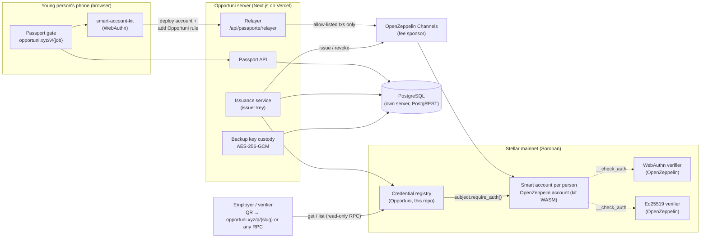
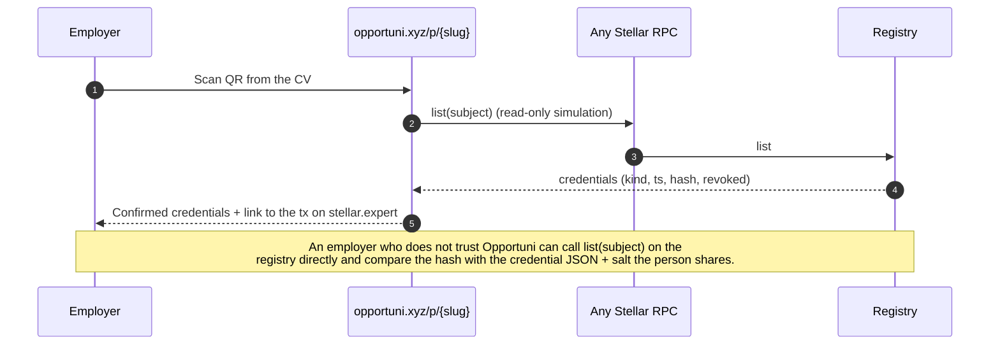

# Opportuni Passport · Technical architecture

Verifiable talent credentials on Stellar for a community of 12k+ young people in Mexico, Colombia and Spain. Every job link Opportuni shares opens through the Passport: the first time, the young person gets a smart account on Stellar mainnet secured with Face ID or fingerprint (passkey); from then on, credentials about them (for example a verified CV) are issued into that account and any employer can verify them on-chain without trusting Opportuni.

| | |
|---|---|
| **Status** | Live on Stellar **mainnet since 29 Sep 2026** |
| **Registry contract** | [`CCYQALCXWORBUAOI2AXRPBRI4JOK2UHYXOZIJZTGKK3MOZAV7LK3CC7P`](https://stellar.expert/explorer/public/contract/CCYQALCXWORBUAOI2AXRPBRI4JOK2UHYXOZIJZTGKK3MOZAV7LK3CC7P) |
| **Issuer account** | [`GCJOMP6DCXSM6SIGGTTVZEQAQLPY5TKCH263F66HRSR5DMBXGOY5C6GX`](https://stellar.expert/explorer/public/account/GCJOMP6DCXSM6SIGGTTVZEQAQLPY5TKCH263F66HRSR5DMBXGOY5C6GX) |
| **Contract source** | [`contracts/credential-registry`](../contracts/credential-registry) (Rust, soroban-sdk 28) |
| **On-chain dashboard** | [dune.com/opportunixyz/opportuni](https://dune.com/opportunixyz/opportuni) · queries in [`analytics/dune`](../analytics/dune) |
| **Real-time numbers** | [opportuni.xyz/traccion](https://opportuni.xyz/traccion) |
| **Product spec (Spanish)** | [prd-pasaporte-opportuni.md](prd-pasaporte-opportuni.md) · routes: [rutas.md](rutas.md) |

## 1. Components



| Component | What it is | Who runs it |
|---|---|---|
| **Smart account** | One OpenZeppelin smart account per person, deployed from the WASM that `smart-account-kit` already has on mainnet. Signer: a **passkey** (WebAuthn verifier) or, as a fallback, an **Ed25519 key** held in encrypted custody by Opportuni until the person adds their passkey. | The person (passkey) / Opportuni (backup) |
| **Delegated permission** | A **context rule** on the account: `CallContract(registry)` with `Delegated(issuer)` as signer, valid for 365 days. It lets the Opportuni issuer satisfy `subject.require_auth()` **only** for calls to the registry. Nothing else: no transfers, no other contracts. | Signed once by the person with Face ID / fingerprint |
| **Credential registry** | Our Soroban contract. Stores, per subject account, credentials as `(id, kind, salted hash, timestamp, revoked)`. Emits `issued`, `revoked`, `issuer_changed` events. Upgradeable in place. | Opportuni (this repo) |
| **Relayer** | Our own route in front of OpenZeppelin Channels. It forwards **only two** transaction shapes: deploying a passkey account (kit deployer, kit WASM, one WebAuthn signer) and adding the Opportuni rule. Anything else is rejected, so nobody can spend the fee budget. | Opportuni |
| **Fee sponsor** | OpenZeppelin Channels pays network fees; if it fails or is exhausted, the issuer account pays (capped at 0.5 XLM/tx). Global cap: 600 Stellar sends per hour. | OpenZeppelin / Opportuni |
| **Verifier** | Anyone. `opportuni.xyz/p/{slug}` shows the person's confirmed credentials with their on-chain proof; an employer can also call `get`/`list` on the registry through any RPC. | Public |
| **Off-chain database** | Passports (profile from the form), devices, job clicks, credential queue. Personal data lives **only** here. | Opportuni, own PostgreSQL server |

## 2. Registry contract: functions and authorization

Source: [`contracts/credential-registry/src/lib.rs`](../contracts/credential-registry/src/lib.rs). Tests: [`src/test.rs`](../contracts/credential-registry/src/test.rs).

| Function | Who must authorize | What it does |
|---|---|---|
| `__constructor(issuer)` | deployer | Sets the issuer address (instance storage) |
| `issue(subject, kind, hash) -> u64` | **subject** (via its delegated rule) **and issuer** | Appends a credential to the subject, bumps the subject's counter, publishes `issued`. Order matters: `subject.require_auth()` runs first so the account's `__check_auth` can resolve the delegated issuer signature |
| `revoke(subject, id)` | issuer | Marks the credential revoked (idempotency error `AlreadyRevoked`), publishes `revoked` |
| `get(subject, id) -> Credential` | nobody (read) | Returns one credential |
| `count(subject) -> u64` | nobody (read) | Number of credentials of the subject |
| `list(subject, start) -> Vec<Credential>` | nobody (read) | Pages of 50 |
| `issuer() -> Address` | nobody (read) | Current issuer |
| `set_issuer(new_issuer)` | issuer | Rotates the issuer key, publishes `issuer_changed` |
| `upgrade(wasm_hash)` | issuer | `update_current_contract`: new code, **same contract ID**, same storage |

Storage:
- **Instance:** issuer. TTL extended to 120 days whenever it drops below 60 (`bump()` on every write).
- **Persistent:** `Count(subject)` and `Cred(subject, id)`. One entry per credential (about 0.1 XLM including rent at issuance).
- **Events:** `issued { subject, id, kind, hash }`, `revoked { subject, id }`, `issuer_changed { issuer }`. Indexed by Dune (`stellar.history_contract_events`).

Credential kinds today: `cv_verif` (Opportuni reviewed the person's CV; paid service, issued manually from /admin). Planned: LinkedIn reviewed, partner credentials (first external issuer: Pokta Labs, interview done and level), and application confirmed by the company. Opening a job link is **not** a credential: it stays off-chain.

## 3. What goes on-chain and what does not

| On-chain (public) | Off-chain (Opportuni database) |
|---|---|
| Smart account address per person | Name, WhatsApp, state, areas of interest, age range |
| Context rule: registry address + issuer address + expiry | Which jobs each person opened, when, from which device |
| Credential `kind`, `timestamp`, `revoked` flag | The credential's content (what was verified, by whom, notes) |
| `hash = sha256(credential JSON ‖ salt)`, 32 bytes | The salt and the JSON that the hash commits to |
| Events with the same fields | Encrypted backup keys (AES-256-GCM, master key only in Vercel) |

Nothing on-chain can be linked to a person without the off-chain salt. Dune and stellar.expert show accounts and credentials, never people.

## 4. Flows

### 4.1 Passport creation (first click on a job link)

```mermaid
sequenceDiagram
  autonumber
  participant P as Person (browser)
  participant S as Opportuni server
  participant R as Relayer
  participant C as Channels
  participant A as Smart account
  P->>S: Form (name, WhatsApp, state, area, age) + Turnstile
  S->>S: Save passport, set device cookie
  P->>P: Face ID #1: create passkey
  P->>R: deploy account (kit deployer, WebAuthn signer)
  R->>R: Validate shape (deployer, WASM, 1 signer)
  R->>C: Sponsored tx
  C->>A: Account deployed
  P->>P: Face ID #2: sign add_context_rule
  P->>R: add_context_rule(CallContract(registry), Delegated(issuer), 365 d)
  R->>C: Sponsored tx
  C->>A: Rule added
  P->>S: Report account; server verifies rule on-chain
  S-->>P: Redirect to the job
  Note over P,A: If the passkey fails or is cancelled, the server deploys a backup account<br/>with an Ed25519 signer (key encrypted in custody) and adds the same rule.
```

### 4.2 Credential issuance

```mermaid
sequenceDiagram
  autonumber
  participant Op as Operator (/admin or MCP)
  participant S as Issuance service
  participant C as Channels
  participant Reg as Registry
  participant A as Subject's smart account
  Op->>S: Issue cv_verificado to passport X
  S->>S: Build credential JSON + random salt, hash = sha256(JSON ‖ salt), store off-chain (state: pending)
  S->>Reg: simulate issue(subject, "cv_verif", hash)
  S->>S: Sign auth entries with the issuer key (as issuer and as delegated signer for the subject)
  S->>C: Submit (fallback: issuer pays)
  Reg->>A: subject.require_auth() → __check_auth(rule: CallContract(registry), signer Delegated(issuer))
  Reg->>Reg: issuer.require_auth(); store Cred; publish issued
  Reg-->>S: id
  S->>S: Mark confirmed, save tx hash
```

### 4.3 Verification



## 5. Security measures in production

- **Relayer allow-list:** only account deployment and the Opportuni rule go through our relayer; everything else is rejected before reaching Channels.
- **Delegated scope:** the issuer can only call the registry on the person's behalf; it has no power over the account's funds or other contracts.
- **Rate limits:** Cloudflare Turnstile at the gate; unverified passports capped at 30/hour; global cap of 600 Stellar sends/hour; issuer fallback capped at 0.5 XLM/tx.
- **Custody:** backup keys encrypted with AES-256-GCM; the master key lives only in Vercel, never on the database server. Backup accounts hold no funds.
- **Privacy:** only salted hashes on-chain; IP stored as HMAC; no third-party pixels.
- **Auditability:** every operator action (issue, revoke, settings) is written to an audit table; token-based access for the operator API and MCP connector.

## 6. Traction (on-chain, as of 8 Nov 2026)

Source: [Dune](https://dune.com/opportunixyz/opportuni), [stellar.expert](https://stellar.expert/explorer/public/contract/CCYQALCXWORBUAOI2AXRPBRI4JOK2UHYXOZIJZTGKK3MOZAV7LK3CC7P) and our database.

| Metric | Value |
|---|---|
| Mainnet launch | 29 Sep 2026 |
| Passports created | 1,578 |
| Smart accounts on mainnet | 1,539 (762 passkey, 777 backup) |
| Credentials issued and confirmed | 2 `cv_verif` (0 revoked); no other kind issued yet |
| Job links opened through the Passport | 3,166 clicks by 1,578 people |
| Gate conversion | The Passport is mandatory to open a job, so 100% of people who reached a job created one. 24.5% of gate views ended in a passport (views include repeats and crawlers) |
| QR verifications | Not measured yet (1 passport page view recorded). Measuring them is part of the roadmap |
| Network fees | ~0.28 XLM per passport (deploy + rule), paid by OpenZeppelin Channels; Opportuni has paid 0.03 XLM |

## 7. Known limitations and the plan for them

| Today (v1) | Planned (v2) |
|---|---|
| **One issuer.** The registry accepts a single issuer address. | **Issuer allow-list** with the kinds each issuer may emit, revocation per issuer. Each external issuer (first: Pokta Labs) gets its **own context rule** on the person's account, approved with their passkey, with the same shape as the Opportuni rule (`CallContract(registry)`, `Delegated(partner issuer)`). |
| **Persistent TTL not extended.** Only the instance is bumped; credential entries keep the network minimum (about 120 days on mainnet; the first two have ~86 days left). An archived entry is never lost: it can be restored with `RestoreFootprintOp`, and the hash is also in the `issued` event. | `extend_ttl` on `Cred` and `Count` entries on every write, plus a monitoring job that watches `liveUntilLedgerSeq` and restores or extends before expiry. Part of the tranche-2 monitoring plan. |
| **Admin = issuer, single key.** `upgrade` and `set_issuer` are authorized by the same hot key that issues credentials. | **Split admin from issuer.** Admin becomes a Stellar multisig account (2-of-3 signers, medium threshold) that alone can `upgrade`, `set_issuer` and manage the issuer allow-list; the issuer stays a hot key for day-to-day issuance and can be rotated by the admin. |
| **`upgrade` implemented, not yet exercised.** It calls `update_current_contract`, which by design keeps the contract ID and storage; existing context rules reference the contract address, so they keep working. It has no unit test and has not been run on testnet yet. | Unit test plus a rehearsal on testnet (deploy v1, issue, upgrade to v2, verify old credentials and rules still resolve) before the mainnet upgrade. |
| **Verification depends on `/p/{slug}`** for a good experience. | Browser-side verification: the employer's browser recomputes the hash and reads the registry via RPC, with no Opportuni API in the path. Open TypeScript SDK (`verify`, `issue`). |
| **Backup accounts** are custodial until the person adds a passkey. | Claim flow: add the passkey as signer, remove the custodial signer, delete the encrypted key. |

## 8. Why our own registry and not SAS or ACTA

We reviewed both on 29 Sep 2026 (code and mainnet usage).

- **Stellar Attestation Service (attestprotocol):** attestations about someone else go through `attest_by_delegation`, where the **subject never signs**; the issuer key is BLS12-381; attestation is permissionless unless a resolver filters; mainnet usage was ~50 calls. Our model needs the person's account to authorize every credential, so an employer knows the person consented.
- **ACTA:** charges 1 USDC per credential, stores the **encrypted credential on-chain** under ACTA's master key, only the **holder** can revoke (an issuer cannot undo a mistake), and its `did:stellar` only accepts classic `G` accounts, not smart accounts. Our registry keeps only a salted hash on-chain, lets the issuer revoke, and works natively with the person's smart account.

Our registry is small on purpose (about 150 lines), uses OpenZeppelin's audited account and verifiers for everything that touches keys, and emits EAS-style events so credentials can be mirrored or indexed by third parties.

## 9. Repository map

| Path | What |
|---|---|
| `contracts/credential-registry/` | Registry contract (Rust) and tests |
| `app/lib/stellar/` | Server-side Stellar code: config, Channels client with issuer fallback, account deployment, rule building, issuance, relayer validation, key custody |
| `app/v/_puerta/` | The gate UI and the browser side of the kit (passkey creation, rule signing) |
| `app/api/pasaporte/` | Gate API, relayer, passkey challenge and verification |
| `app/p/[slug]/` | Public passport page (verification) |
| `app/traccion/` | Public real-time traction page |
| `analytics/dune/` | Dune queries behind the public dashboard |
| `db/migrations/` | Database schema (SQL) |
| `docs/prd-pasaporte-opportuni.md` | Product spec, decisions and phase plan (Spanish) |
